# AGRASIC Digital — Design Reference

**Current state only.** This is the short companion to
[`agriasic_digital_MAS.md`](agriasic_digital_MAS.md), which is a living record
of ~3,000 lines including every superseded decision and the reasoning behind
it. If you want to know *why* something is the way it is, or what it used to
be, go there. If you want to know what the design *is* today, this is enough.

Everything below describes RTL that exists and passes the 15-stage regression.
Where something is assumed, blocked or unverified it says so.

---

## 1. What the chip does

AgriASIC measures **soil impedance** to infer moisture and nutrient content. A
four-electrode (tetrapolar) probe drives current through the soil on **E1** and
returns it on **E4**, while sensing the resulting voltage differentially across
the inner pair **E2/E3**. The four-wire arrangement keeps electrode contact
resistance out of the measurement.

The chip sweeps three excitation frequencies — **10 MHz, 100 kHz, 1 kHz** — and
reports, for each, four accumulated numbers: the in-phase and quadrature parts
of the sensed voltage and of the return current. **Impedance `Z(f) = ΔV(f) / I(f)`
is computed host-side, never on die.**

The design constraint that shapes everything else: **the chip must run with no
external microcontroller.** It boots itself, measures itself, and holds results
until someone collects them.

---

## 2. Architecture at a glance

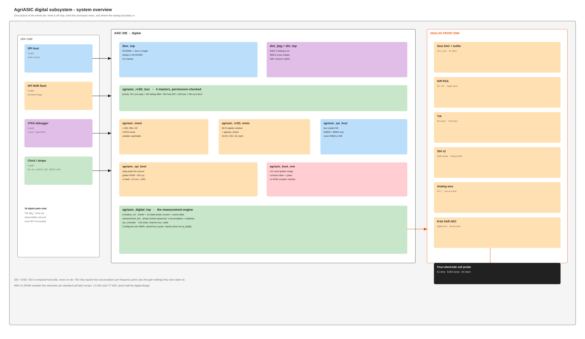

Three partitions:

- **A processor as a policy layer.** The Ibex core chooses frequencies, sets
  settle times, packs results and services hosts. **It never touches a sample.**
- **A measurement engine in hardware.** All real-time work — excitation,
  phase-locked sampling, the SAR bit trials — runs in dedicated logic with
  fixed timing.
- **An analog front end** sharing one ADC between both sense channels.

### Address map

| Region               | Base            | Size  | Reachable by                        |
| -------------------- | --------------- | ----- | ----------------------------------- |
| IMEM                 | `0x0000_0000` | 1 KiB | fetch, data, debug SBA, boot loader |
| DMEM                 | `0x0001_0000` | 512 B | data, debug SBA, host SPI           |
| Debug module         | `0x1A11_0000` | 4 KiB | fetch (debug ROM), data             |
| Peripheral registers | `0x8000_0000` | 64 B  | data, debug SBA, host SPI           |
| anything else        | —              | —    | bus error → precise trap           |

### Pads — 18 digital

4 host SPI · 4 flash SPI · 5 JTAG · `clk` · `rst_n` · `BOOT_SEL` · `BOOT_FAIL` ·
`START`

> The `dbg_*` ports exist so simulation and the audit flows can observe internal
> state without hierarchical references. **They are not pads and must not be
> bonded.** The prefix convention is: `gpio_` leaves the die, `afe_` goes to the
> analog front end, `dbg_` is observability only, and unprefixed is die-internal
> block-to-block wiring.

---

## 3. Module reference

### Control subsystem

#### `agriasic_rv32i_control_shell` — the MCU

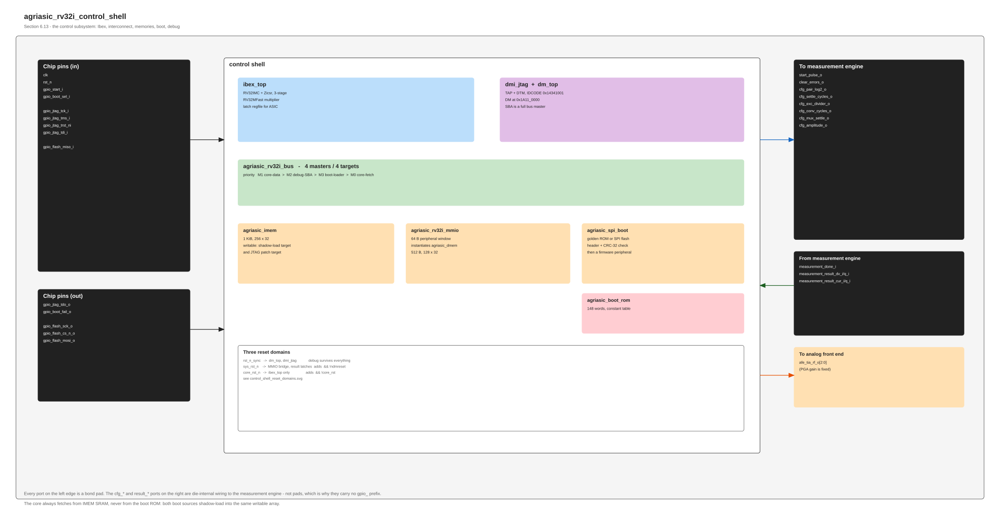

Instantiates the core, interconnect, memories, boot loader, golden ROM and debug
module, and owns **three reset domains**:

| Domain         | Resets                      | Formed from         |
| -------------- | --------------------------- | ------------------- |
| `rst_n_sync` | debug module, TAP                               | `rst_sync` output |
| `sys_rst_n`  | MMIO bridge, result latches, measurement engine | `&& !ndmreset`    |
| `core_rst_n` | Ibex only                                       | `&& !core_rst`    |

The debug module deliberately survives `ndmreset` — otherwise a debugger would
disconnect itself the moment it asked for a reset.

The **measurement engine shares the bridge's domain**, not the wider
`rst_n_sync`. It previously sat on `rst_n_sync`, so a debugger's `ndmreset`
cleared the bridge's `busy`/`done` state while the engine kept sequencing; the
run's eventual completion then set `done` in a bridge that had never seen a
start, presenting a stale result as a fresh one. Anything that reports the
engine's state has to be reset with it.

#### `ibex_top` — the core

RV32IMC + Zicsr, 3-stage, `RV32MFast`, branch-target ALU, writeback stage. Latch
register file for ASIC. Vendored from lowRISC at `e9f5534`, **unmodified except
one documented lint-sink patch**.

Two integration details that cost real debugging: `DmExceptionAddr` is `+0x810`,
not Ibex's default `+0x808`; and Ibex gates its own clock while idle, so its
async-reset flops need a genuine reset edge.

#### `agriasic_rv32i_bus` — the interconnect

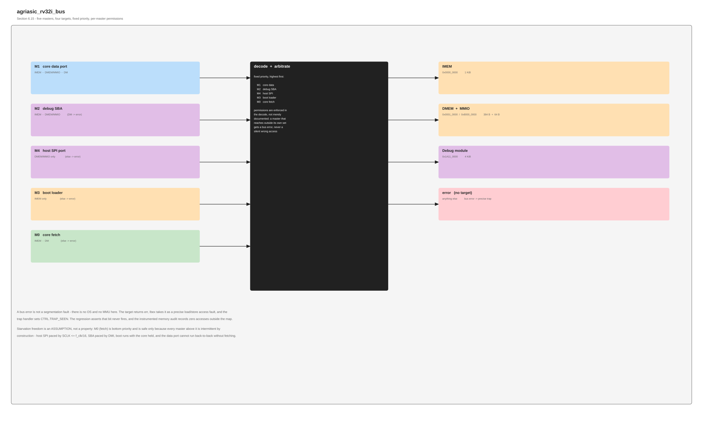

Five masters, fixed priority **M1 core-data > M2 debug-SBA > M4 host-SPI > M3
boot > M0 core-fetch**. Permissions are enforced **in the decode**, not by
convention:

| Master         | May reach          |
| -------------- | ------------------ |
| M0 core fetch  | IMEM, debug module |
| M1 core data   | everything         |
| M2 debug SBA   | IMEM, DMEM/MMIO    |
| M3 boot loader | IMEM only          |
| M4 host SPI    | DMEM/MMIO only     |

M4 cannot reach IMEM (a field host must not overwrite firmware) or the debug
module (it must not take debug control). Out-of-map access is a bus error, which
Ibex takes as a precise fault — **not a segfault; there is no OS and no MMU.**

#### `agriasic_imem` / `agriasic_dmem` — the memories

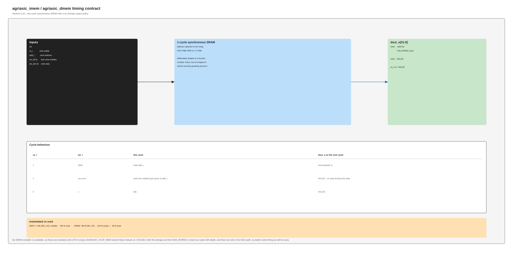

IMEM **1 KiB (256 × 32)**, DMEM **512 B (128 × 32)**, sized to measured use
(592 B image, 100 B data) rather than round numbers.

**There is no SRAM compiler**, so these are standard-cell **latch arrays** —
`AGRIASIC_FLOP_MEM` selects flops instead at a cost of 28 kGE. The write path
follows lowRISC's latch register file: global clock gate → **data and byte
enables registered** → per-word clock gate off the **combinational** address →
latch. The address is deliberately not registered; a clock-gating cell samples
its enable while the clock is low, so a registered address lands every write at
the previous address.

Timing contract, unchanged by the storage choice: one-cycle synchronous read,
no-change output policy.

#### `agriasic_rv32i_mmio` — peripheral bridge

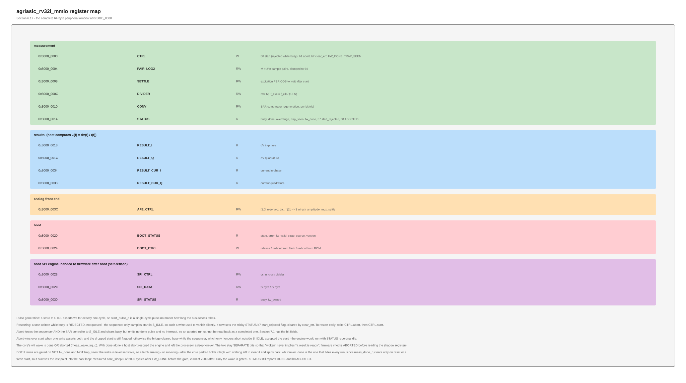

Decodes the data port into DMEM and a 64-byte register window. Decode is
**full** — the earlier version looked only at `addr[31]` and `addr[4:2]`, so
every peripheral aliased across the upper half of the map.

A store to `CTRL` asserts write-enable for exactly one cycle, so `START` is a
single-cycle pulse regardless of bus timing.

**Restarting a run.** `START` written while the engine is busy is **rejected**,
not queued and not silently dropped: the sequencer only samples `start` in
`S_IDLE`, so such a write used to vanish with no way for firmware to tell. It
now sets the sticky `STATUS[7]` *start-rejected* flag, cleared by
`CTRL.clear_err` like the other sticky bits. To restart early, write
`CTRL.ABORT` (bit 1) and then `CTRL.START`. Abort forces both the measurement
sequencer and the SAR controller back to `S_IDLE` and clears `busy`; it produces
**no** `done` pulse, so an aborted run cannot be mistaken for a completed one.
The accumulators are zeroed by the next start rather than by the abort, so the
previous complete result stays readable in the shadow registers.

Aborting the SAR controller as well as the sequencer is not redundant: a
conversion left in flight would otherwise run to completion and pulse
`sample_done` into the *next* run.

`ABORT` wins over `START` when one write asserts both, and the dropped start is
still flagged. Without that precedence the two disagreed — the bridge cleared
`busy` while the sequencer, which only honours abort outside `S_IDLE`, accepted
the start — leaving the engine running with `STATUS` reporting idle.

Also decodes the **TIA's 2-bit gain code into three switch wires**. No code
decodes to all-open — that would be an open feedback network and a railed
output, and the reset code is 0. The **diff PGA has a fixed gain** and no
digital control: ΔV is a fixed fraction of the drive set by electrode geometry,
so the voltage channel has little dynamic range. `AFE_CTRL[1:0]` is reserved.

### Boot

#### `agriasic_spi_boot` — boot loader and post-boot SPI master

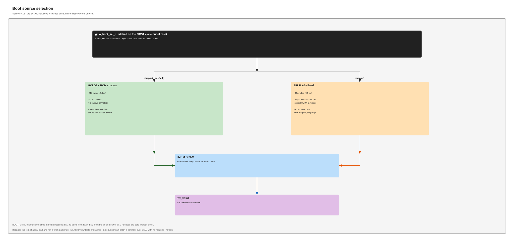
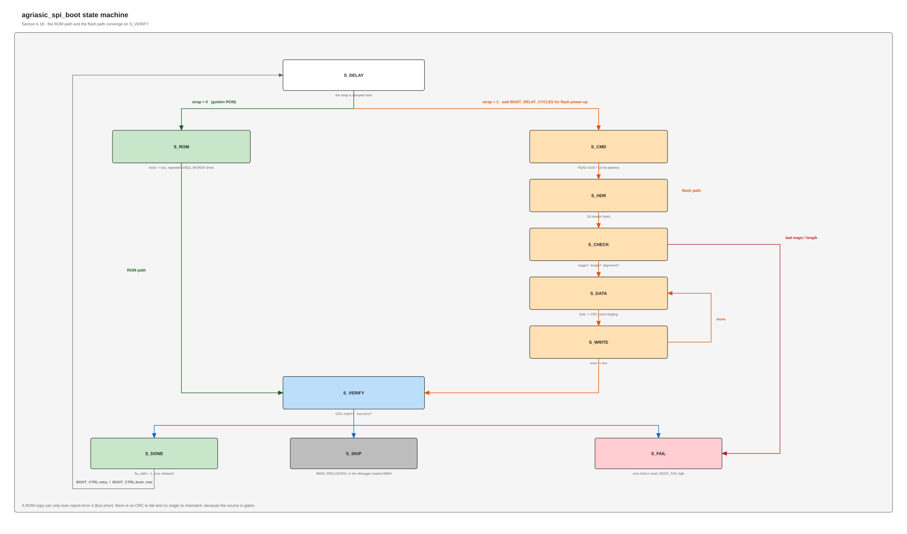

`BOOT_SEL` is latched on the first cycle out of reset — a strap, not a runtime
control.

| Strap                 | Source             | Time        | Integrity                  |
| --------------------- | ------------------ | ----------- | -------------------------- |
| **0** (default) | on-die golden ROM  | ~150 cycles | none needed — it is gates |
| 1                     | external SPI flash | ~0.5 ms     | 16-byte header + CRC-32    |

**Both shadow-load into the same writable IMEM.** The core always fetches from
SRAM, never from ROM — so nothing is added to fetch timing, firmware links once
for both sources, and **IMEM stays patchable over JTAG after a ROM boot**. A bad
magic, length, CRC or bus error holds the core in reset with `BOOT_FAIL` raised.
After boot the same engine becomes a firmware SPI peripheral, so the chip can
rewrite its own flash.

#### `agriasic_boot_rom` — the golden image

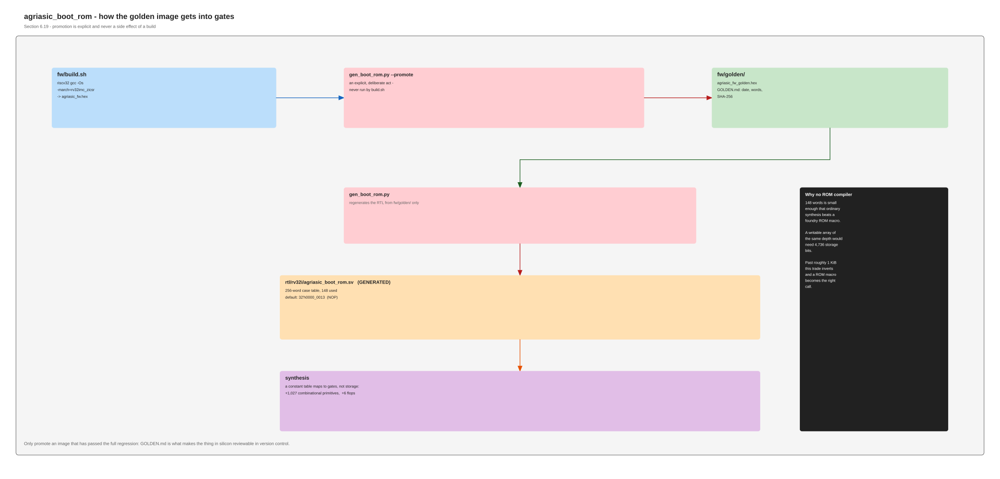

141 words emitted as a constant `case` table — **no ROM compiler needed**;
synthesis maps it to ~1,000 gates. Promotion is explicit (`gen_boot_rom.py --promote`), never a side effect of a build, and the generator keeps the word
count in step everywhere it appears.

### Debug and host access

#### `dmi_jtag` + `dm_top` — RISC-V debug

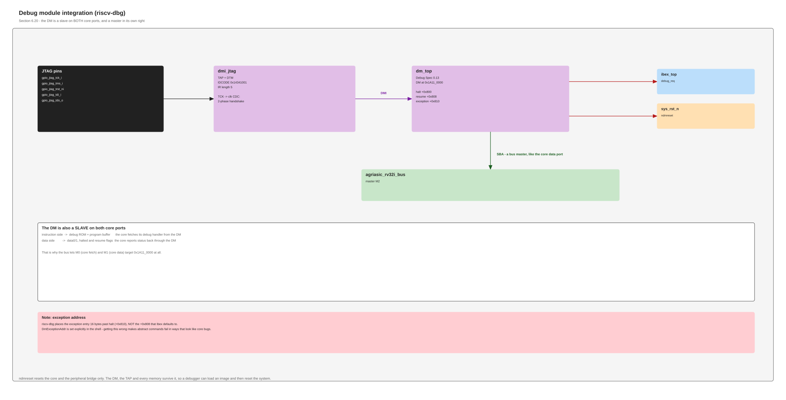

pulp-platform `riscv-dbg`, Debug Spec 0.13. Five pins, IDCODE `0x1434_1001`.
Works with a stock J-Link and OpenOCD — no custom host software. Its system-bus
port is a **full bus master**, so a debugger reads and writes memory while the
core runs; that is how firmware gets patched at the bench.

#### `agriasic_spi_host` — host port

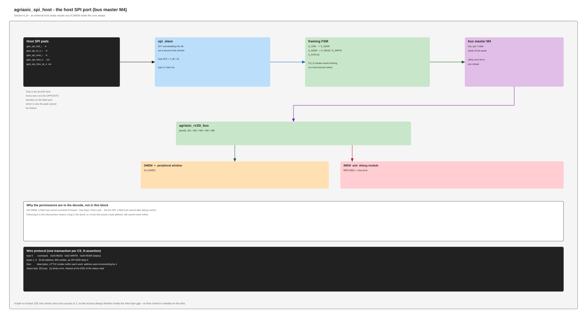

The chip is the **slave**. Gives an external host its own bus master (M4) rather
than a mailbox, so it reads a finished sweep straight out of DMEM **while the
core sleeps** — no firmware cooperation, no handshake to get wrong.

Protocol: command (`0x03` read / `0x02` write / `0x05` status), 32-bit
big-endian address, then data little-endian per word with auto-increment. CS_N
release resets framing. Max SCK is **f_clk/16** — the pins are oversampled, not
a second clock domain.

> Host and flash SPI are on **separate pads** because the roles are opposite:
> SCK, CS_N and MOSI are inputs here and outputs there.

### Measurement engine

#### `excitation_ctrl` — waveform and phase reference

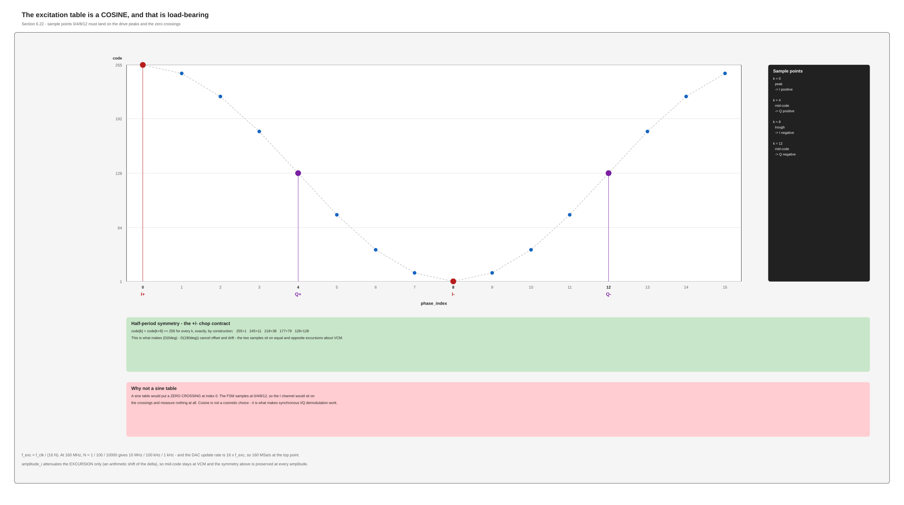

A **16-point cosine table held in logic** — no memory read, no DMA — indexed by
a phase counter off a programmable divider. `f_exc = f_clk / (16N)`.

Cosine, not sine, is load-bearing: the FSM samples at indices 0/4/8/12, so the
peaks must land on the I points. A sine table would put a zero crossing at index
0 and the I channel would measure nothing. `code[k] + code[k+8] = 256` exactly,
which is what makes the ± chop cancel offset and drift.

#### `measurement_fsm` — the sequencer

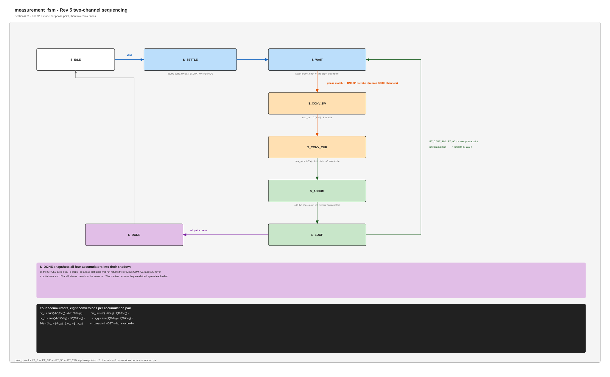
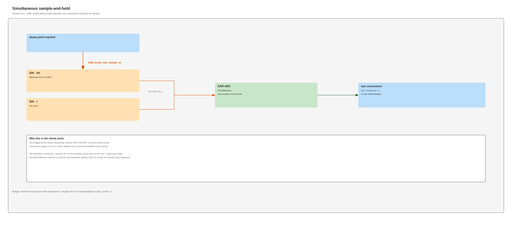

Waits for a phase match, issues **one sample-and-hold strobe that freezes both
channels**, then converts them in turn. The voltage/current phase relationship
is set by that single instant, so skew between the two conversions costs
nothing.

Four phase points × two channels = **8 conversions per accumulation pair**, into
four accumulators. All four **snapshot into shadow registers on the single cycle
`busy` drops**, so a mid-run read returns the previous complete result and ΔV
and I always come from the same run — which matters because they are divided
against each other.

#### `sar_controller` — the converter

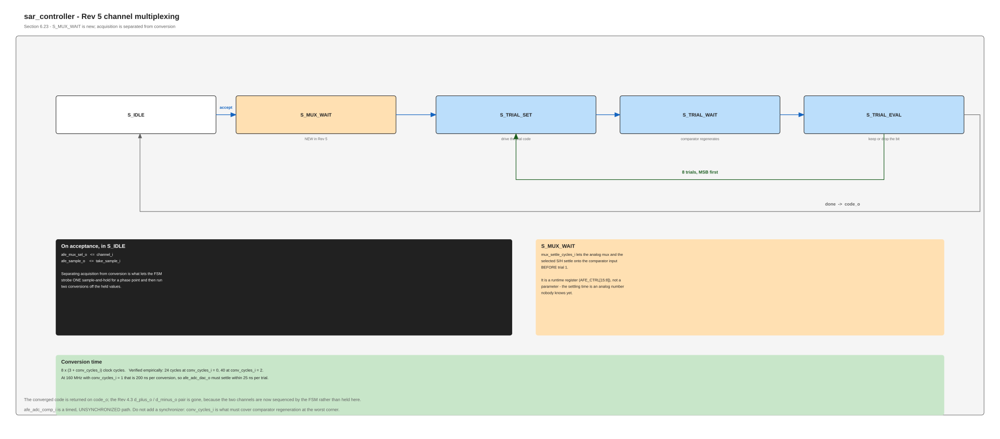

Runs the successive-approximation search **in digital**: eight bit trials, one
comparator decision each. Conversion is `8 × (3 + conv_cycles)` cycles. Reports
**overrange** when the converged code sits on a rail, latched per channel — the
gain controls exist to fix that, so firmware has to be able to see it.

`afe_adc_comp_i` is deliberately **unsynchronized** — `conv_cycles` covers
regeneration instead, because a synchronizer would cost a full bit trial.

#### `rst_sync` — reset synchronizer

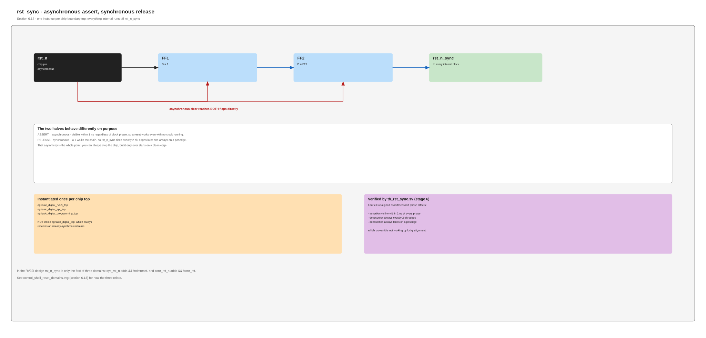

Asynchronous assert, synchronous release. One per chip top.

---

## 4. Software interface

Firmware writes configuration, pulses `CTRL.START`, executes **`wfi`**, and is
woken by `irq_fast[0]` from a sticky DONE latch. `mie.fast0` is set but
`mstatus.MIE` is not, so the core **resumes at the next instruction rather than
taking a trap** — no handler, no context save. The core is idle **99.98%** of a
sweep.

Because an abort emits no DONE pulse, it cannot wake a core already parked in
`wfi`. `CTRL.ABORT` is therefore a **host- and debugger-side** control — a way
to reclaim a stuck engine over the host SPI port or the debug module's system
bus — and not part of the firmware's own wait path. Firmware never needs it: it
starts one run and is woken by that run's completion.

Firmware is **564 B**, no heap, no libc, 28 B of stack. Results land in DMEM at
`0x100`–`0x16B`, each point stored with the `AFE_CTRL` value and overrange flags
it was measured under — without those a host cannot compute `Z` correctly, since
the two channels have independent gains that do not cancel in the ratio.

Measurement sequence: [`agriasic_digital_v2_measurement_sequence.puml`](agriasic_digital_v2_measurement_sequence.puml) — updated for Rev 5 and Ibex.
The rendered `.svg` beside it is **stale** (it still shows the single-channel
Rev 4.3 flow); regenerate with `plantuml` against the `.puml`. There is a JRE
under `.tools/plantuml/` but no `plantuml.jar`, so it cannot be re-rendered
from this tree as it stands.

---

## 5. Where it stands

**Verification** — 15-stage regression, ~180 checks across 13 testbenches: unit
tests, an end-to-end firmware sweep, the real JTAG DTM/DMI protocol, seven boot
scenarios, and the host SPI port. An instrumented memory audit confirms **zero
out-of-map accesses**. A flop/latch equivalence run confirms the memory variants
are bit-identical.

**Area** — ~153 kGE: logic 76, memories 77. Estimated 1.3–2.2 mm² digital, giving
a die of **4.5–5.7 mm² against a 5 mm² budget**. See
[`../timing/README.md`](../timing/README.md) for method and limits.

### Open, and who owns it

| Item                                                                                                                   | Owner                          |
| ---------------------------------------------------------------------------------------------------------------------- | ------------------------------ |
| Analog interface conventions — comparator polarity, DAC coding, simultaneous S/H, TIA gain table, settling, DAC rate | **analog** |
| Fixed PGA gain value, and whether `AFE_CTRL.amplitude` will ever be reduced (the voltage channel has no gain to recover it) | **analog** |
| 160 MSa/s sine DAC at the 10 MHz point — may force fewer phase points or a lower top frequency                        | **analog**               |
| Temperature channel (external thermistor into ADC channel 2)                                                           | analog + digital               |
| Static timing analysis — needs a Liberty library                                                                      | digital, blocked               |
| DFT decision — no scan exists anywhere                                                                                | **decide before layout** |
| `START` polarity (unbonded pin currently leaves the chip dead)                                                       | digital                        |
| GAP-10 placeholder registers                                                                                           | digital                        |

**Two things that would pass silently if wrong:** the analog conventions above,
because the testbench models assume them; and the Ibex ISA, because no
compliance suite has been run against it — we rely on it being upstream-verified
since it is vendored unmodified.
